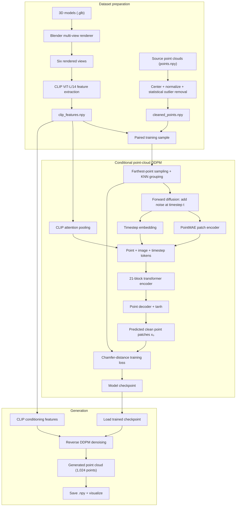

# 3D Point-Cloud Generation

An experimental pipeline for preparing 3D-model data and training a
CLIP-conditioned DDPM to generate point clouds. The project includes Blender
rendering utilities, point-cloud preprocessing, image feature extraction,
model training, and a basic generation/visualization script.

## Pipeline overview

1. **Render model views** with `render_glb.py`. It scans a dataset directory
   for `.glb` files and renders multiple views into an `images` folder.
2. **Prepare point clouds** as `points.npy` files, then run `sor.py` to center,
   normalize, and remove statistical outliers. The output is
   `cleaned_points.npy`.
3. **Extract image features** with `encode.py`. It encodes the six expected
   views (`r_0.png` through `r_5.png`) with CLIP and saves
   `clip_features.npy` and `clip_mean.npy`.
4. **Train the diffusion model** with `model/train.py`, using the CLIP features
   and cleaned point clouds.
5. **Generate a point cloud** with `model/test.py` using a trained checkpoint
   and a model's CLIP features.

The renderer does not create `points.npy`; provide that file for each model
using your own point-cloud export/conversion workflow.

## System architecture



The training code groups each cloud into 32 patches of 32 points. For each
training step, it noises the grouped cloud, fuses point, image, and timestep
tokens in the transformer, and decodes a clean-cloud prediction. The active
training objective is Chamfer distance; the MSE value returned by the model
is a zero-valued placeholder for logging compatibility. At inference, reverse
diffusion starts from random noise and is conditioned on the six-view CLIP
features.

## Dataset layout

The data scripts expect a root directory containing `Batch_1`, `Batch_2`, and
`Batch_3`. Each batch contains one directory per model:

```text
Dataset/
|-- Batch_1/
|   `-- model_id/
|       |-- model.glb
|       |-- points.npy
|       |-- cleaned_points.npy
|       |-- clip_features.npy
|       `-- images/
|           |-- r_0.png
|           |-- r_1.png
|           |-- ...
|           `-- r_5.png
|-- Batch_2/
`-- Batch_3/
```

`points.npy` and `cleaned_points.npy` should contain an array of 3D points with
shape `(number_of_points, 3)`. The training dataset uses
`cleaned_points.npy` when available and falls back to `points.npy`.

## Requirements

- Python 3.10+ recommended
- PyTorch (CUDA recommended for training)
- NumPy, Matplotlib, scikit-learn, and tqdm
- Open3D for statistical outlier removal
- Pillow and OpenAI CLIP for image feature extraction
- Blender for running `render_glb.py` (the script uses Blender's `bpy` API)

Install the Python dependencies in an environment appropriate for your
platform and CUDA version. For example:

```powershell
py -m venv .venv
.\.venv\Scripts\Activate.ps1
python -m pip install --upgrade pip
python -m pip install numpy matplotlib scikit-learn tqdm open3d pillow torch
```

Install OpenAI CLIP separately if it is not already available in your
environment. Choose a PyTorch build compatible with your installed CUDA
version, or install the CPU build if you do not have a supported GPU.

## Configuration

The scripts currently use hard-coded paths and settings. Before running them,
update the dataset, checkpoint, and input paths near the top of each script:

- `render_glb.py`: `ROOT_DIR` and Blender render settings
- `sor.py`: `ROOT`
- `encode.py`: `ROOT_DIR`
- `model/train.py`: `DATASET_ROOT`, checkpoint settings, and training
  hyperparameters
- `model/test.py`: `MODEL_PATH` and `CLIP_FEATURE_PATH`

The `F:\Dataset` and `E:\myProgramme\3d_gen_model\...` paths in the scripts are
examples from the original development environment and will not work on other
machines without editing.

## Running the scripts

Run the Python preprocessing and model scripts from the project directory:

```powershell
python sor.py
python encode.py
python .\model\train.py
python .\model\test.py
```

Run the renderer with Blender's Python environment:

```powershell
blender --background --python render_glb.py
```

Each script uses the paths configured in its source; review those values
before starting a potentially long render or training run. Training writes
checkpoints under `model/checkpoints` and updates `training_progress.png`.
Generation saves `generated_pointcloud.npy` and displays a 3D visualization
when enabled in `model/test.py`.

## Other utilities

- `compare_models.py` — runs a small Hopfield-network capacity experiment.
- `check_data.py` — checks for `cleaned_points.npy` in a separately configured
  dataset location.
- `model/` — DDPM, ViT encoder, point-cloud preprocessing helpers, and
  experimental model components.

## Notes

- Dataset files, virtual environments, model weights, and generated outputs
  are excluded by `.gitignore`; keep backups of large artifacts separately.
- This repository does not currently include a pinned dependency file or
  automated tests.

## Research papers and background

These papers provide background for the techniques used here. They are
references, not a claim that this project reproduces each paper's full method.

- [Learning Transferable Visual Models From Natural Language Supervision
  (CLIP)](https://arxiv.org/abs/2103.00020) — image encoder used to produce
  conditioning features from rendered views.
- [Denoising Diffusion Probabilistic Models](https://arxiv.org/abs/2006.11239)
  — foundational DDPM formulation for the forward and reverse diffusion
  process.
- [Improved Denoising Diffusion Probabilistic Models](https://arxiv.org/abs/2102.09672)
  — includes the cosine noise schedule used by the model.
- [Point-BERT: Pre-Training 3D Point Cloud Transformers With Masked Point
  Modeling](https://arxiv.org/abs/2111.14819) — point-cloud transformer
  pretraining background relevant to patch/token representations.
- [Point-MAE: Masked Autoencoders for Point Cloud Self-supervised
  Learning](https://arxiv.org/abs/2203.06604) — point-cloud patch encoding
  and masked-autoencoder background.
- [Point·E: A System for Generating 3D Point Clouds from Complex
  Prompts](https://arxiv.org/abs/2212.08751) — related work on diffusion-based
  point-cloud generation.
- [PointNet++: Deep Hierarchical Feature Learning on Point
  Sets](https://arxiv.org/abs/1706.02413) — point-set processing background,
  including hierarchical neighborhood sampling.
